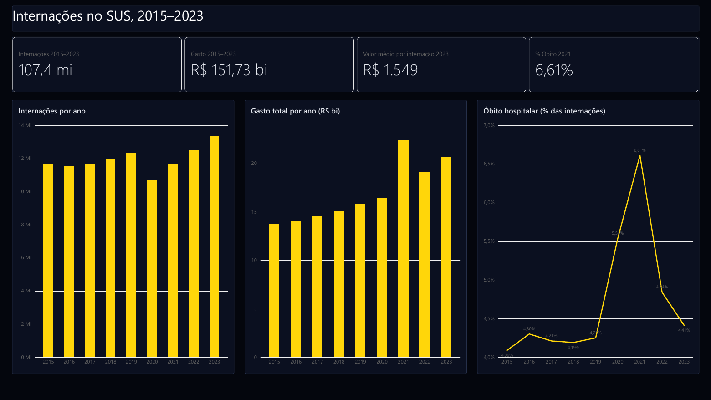
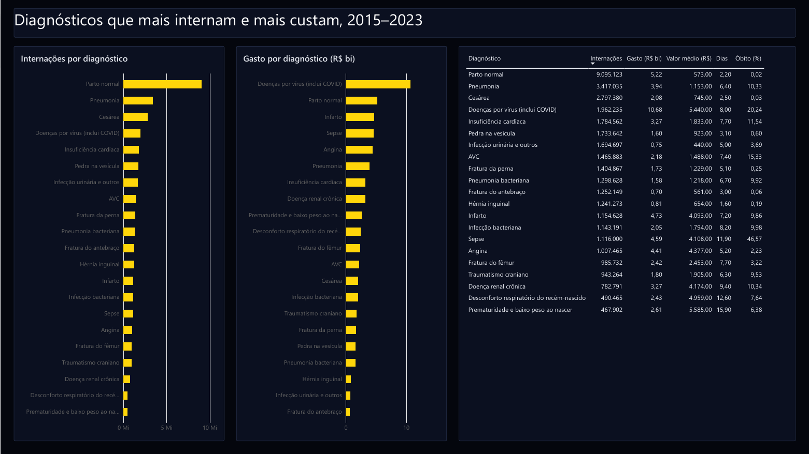
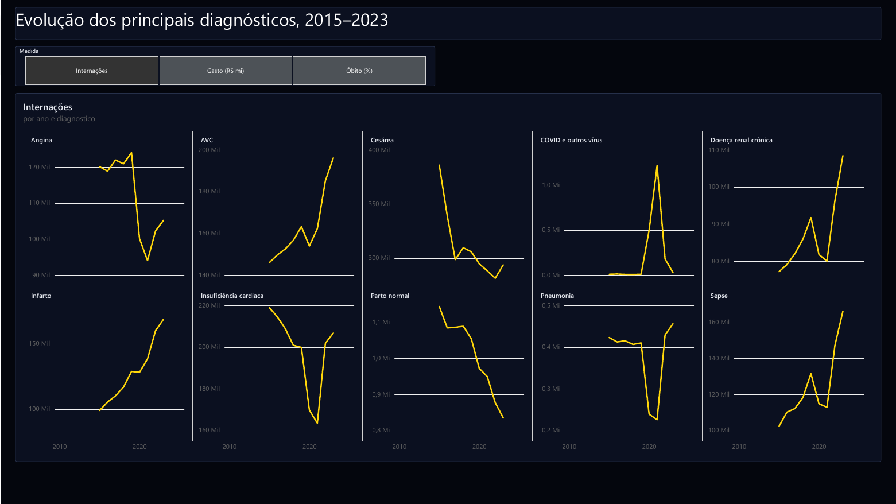
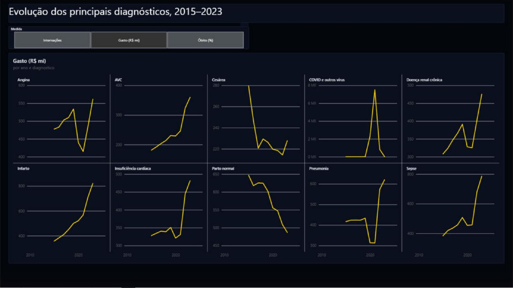
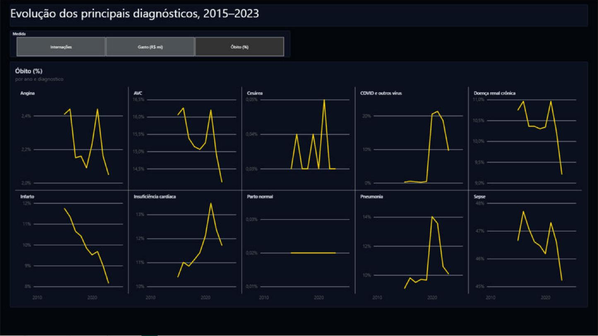
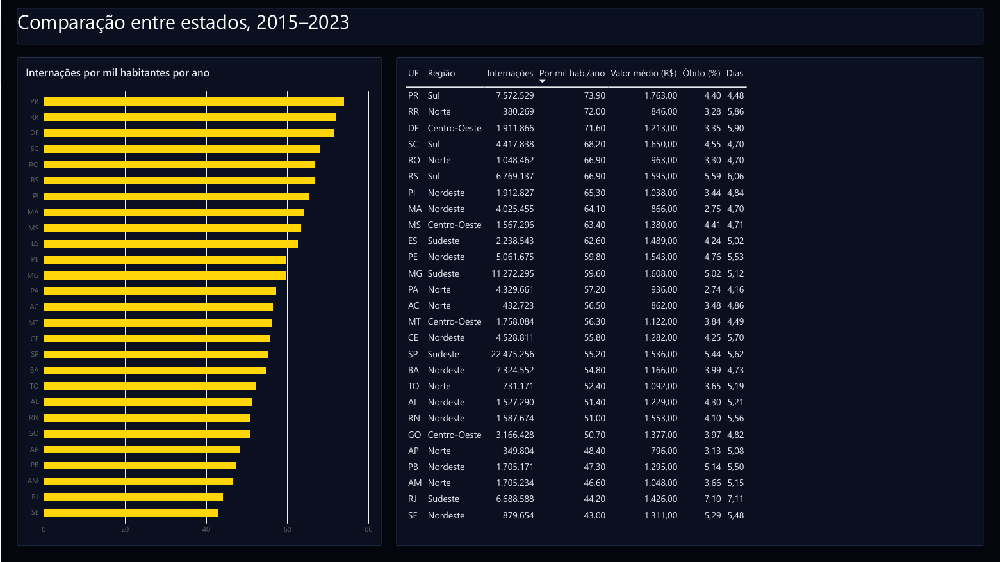

# Internações no SUS, 2015–2023

Análise de **107 milhões de internações** financiadas pelo SUS entre 2015 e 2023, a partir dos microdados do SIH/SUS (Sistema de Informações Hospitalares) disponibilizados pela Base dos Dados no Google BigQuery.

Perguntas que o projeto responde:

1. Como o volume, o custo e a mortalidade das internações mudaram ao longo dos anos?
2. Quais diagnósticos mais internam e quais mais custam?
3. Como os principais diagnósticos evoluíram, antes, durante e depois da pandemia?
4. Como os estados se comparam em taxa de internação, custo e óbito?

## Principais achados

- **R$ 151,7 bilhões** pagos em 107,4 milhões de internações entre 2015 e 2023 (valores da época, sem correção pela inflação).
- **A COVID foi a internação mais cara do período**: R$ 10,7 bi, mesmo sendo só a 4ª causa em volume. O valor médio, de R$ 5.440, é quase dez vezes o de um parto normal.
- **Pandemia**: em 2020 o número de internações caiu 13,5% em relação a 2019, mas a taxa de óbito hospitalar subiu de 4,25% para 6,61% em 2021.
- **Sepse** tem a maior letalidade entre os diagnósticos mais frequentes: 46,6% das internações terminam em óbito.
- **Infarto cresceu 71%** em internações de 2015 a 2023, enquanto a taxa de óbito caiu de 11,7% para 8,2%. **Partos caíram** 27% (normal) e 24% (cesárea).
- **Estados**: o Paraná tem a maior taxa de internação (73,9 por mil habitantes por ano) e o maior valor médio (R$ 1.763). O Rio de Janeiro tem a maior taxa de óbito hospitalar (7,1%) e as internações mais longas (7,1 dias).

Os resultados completos estão em [`resultados/`](resultados/).

| Diagnóstico (CID-10) | Internações | Gasto total | Óbito |
|---|---|---|---|
| Parto normal (O80) | 9,1 mi | R$ 5,2 bi | 0,02% |
| Pneumonia (J18) | 3,4 mi | R$ 3,9 bi | 10,3% |
| Cesárea (O82) | 2,8 mi | R$ 2,1 bi | 0,03% |
| Doenças por vírus, inclui COVID (B34) | 2,0 mi | R$ 10,7 bi | 20,2% |
| Insuficiência cardíaca (I50) | 1,8 mi | R$ 3,3 bi | 11,5% |
| Infarto (I21) | 1,2 mi | R$ 4,7 bi | 9,9% |
| Sepse (A41) | 1,1 mi | R$ 4,6 bi | 46,6% |

## Dados

| Tabela | Uso |
|---|---|
| `basedosdados.br_ms_sih.aihs_reduzidas` | Microdados de internação (uma linha por AIH) |
| `basedosdados.br_bd_diretorios_brasil.cid_10` | Descrição dos códigos CID-10 |
| `basedosdados.br_bd_diretorios_brasil.uf` | Códigos IBGE, siglas e regiões das UFs |
| `basedosdados.br_ibge_populacao.uf` | População estimada por UF e ano |

## Qualidade dos dados

Parte do trabalho foi encontrar e contornar problemas da tabela de internações (checado em 03/11/2026):

| Problema | Como foi tratado |
|---|---|
| `sigla_uf` vem vazia (NULL) em 100% das linhas | UF derivada dos 2 primeiros dígitos do código IBGE do município do hospital (`id_municipio_estabelecimento`) |
| O CID principal vem dividido em duas colunas: códigos de 4 caracteres em `cid_principal_subcategoria` e de 3 em `cid_principal_categoria`. Usando só uma delas, 90% das internações ficam sem diagnóstico | `COALESCE(SUBSTR(cid_principal_subcategoria, 1, 3), cid_principal_categoria)` |
| 2024 tem competências duplicadas (16,7 mi de internações contra 13,3 mi em 2023) | Ano excluído |
| 2025 tem competências faltando | Ano excluído |

O recorte final é **2015–2023**. Para validar, os totais por estado e por ano foram comparados e batem (107.368.293 internações nas duas somas), assim como a soma anual de cada diagnóstico com o ranking geral.

## Como reproduzir

1. Crie um projeto no [Google Cloud](https://console.cloud.google.com). O modo Sandbox do BigQuery é gratuito e não pede cartão.
2. Faça login localmente:
   ```bash
   gcloud auth application-default login
   ```
3. Instale as dependências:
   ```bash
   python -m venv .venv
   source .venv/bin/activate      # Windows: .venv\Scripts\activate
   pip install -r requirements.txt
   ```
4. Copie `.env.example` para `.env` e preencha o ID do seu projeto.
5. Rode os scripts em ordem:
   ```bash
   python src/01_listar_tabelas.py         # testa a conexão e lista as tabelas do SUS
   python src/03_sih_colunas.py            # colunas e amostra da tabela de internações
   python src/04_sih_visao_geral.py        # internações por ano e UF
   python src/05_ranking_diagnosticos.py   # diagnósticos que mais internam e mais custam
   python src/06_evolucao_e_estados.py     # evolução dos diagnósticos e comparação entre estados
   ```
   As saídas vão para `data/`.

### Custo

O `src/bq.py` faz um *dry run* antes de cada consulta e cancela se ela for ler mais que `MAX_GB` (padrão 5 GB). A tabela do SIH é uma view sobre arquivos: o dry run mostra 0 B e as consultas deste projeto não consumiram a cota gratuita do BigQuery.

## Estrutura

```
├── src/
│   ├── bq.py                       # conexão com o BigQuery e trava de custo
│   ├── 01_listar_tabelas.py
│   ├── 03_sih_colunas.py
│   ├── 04_sih_visao_geral.py
│   ├── 05_ranking_diagnosticos.py
│   └── 06_evolucao_e_estados.py
├── sql/                            # consultas, separadas do código
├── resultados/                     # tabelas finais usadas no dashboard
├── powerbi/                        # dashboard em Power BI (.pbix, PDF, prints, guia, consultas M, DAX, tema)
├── requirements.txt
└── .env.example
```

## Dashboard em Power BI

A pasta `powerbi/` tem o dashboard em quatro páginas (visão geral, diagnósticos, evolução e estados). As consultas do Power Query leem os CSVs de `resultados/` direto do GitHub, então o relatório abre e atualiza sem baixar nada. O passo a passo para montar do zero está em [`powerbi/GUIA.md`](powerbi/GUIA.md) e o relatório completo em [PDF](powerbi/internacoes-sus.pdf). Para abrir no Power BI Desktop, baixe o [`internacoes-sus.pbix`](powerbi/internacoes-sus.pbix).



<details>
<summary>Outras páginas</summary>







</details>

## Ferramentas

BigQuery · SQL · Python · pandas · Power BI (Power Query, DAX)

## Fontes

- [Base dos Dados](https://basedosdados.org)
- [DataSUS](https://datasus.saude.gov.br)
